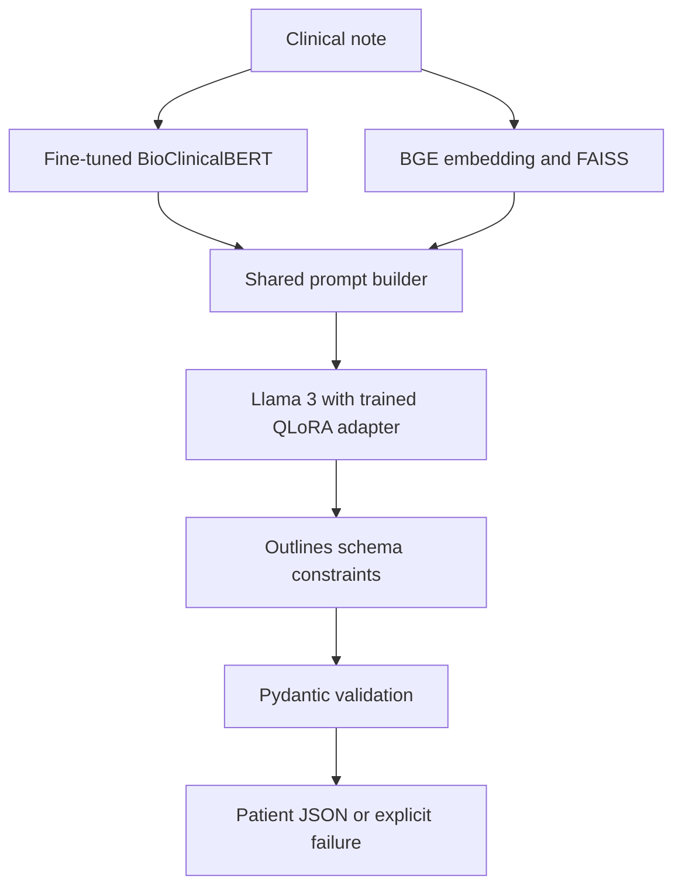

# Clinical note → validated patient JSON

BioClinicalBERT token classification + BGE-Large/FAISS example retrieval +
Llama-3-8B-Instruct NF4 QLoRA + Outlines constrained generation + Pydantic.
An explicit rules baseline is also provided. Model mode never silently substitutes
rules, random predictions, guessed demographics, or a default diagnosis.

## Status and evidence

This repository implements the architecture, not pretrained task-specific weights.
You must train NER and Llama adapters before model-mode inference. No trained
checkpoints or full-model clinical benchmark are supplied in this change.

The original CV/README numbers (0.91 NER F1, 0.89 MRR, 93.1% Hit@3, 99.2%
schema validity, 0.94 field accuracy, 3.4× throughput) are **unverified historical
claims**, not reproduced results. None are hard-coded as achieved metrics.

Dataset audit performed on the checked-in data:
- Labeled CSV: 10,822 notes, columns `ID, Note, json`, 20 visit categories.
- Unlabeled test CSV: 3,796 notes, columns `ID, Note`.
- Targets: demographics, visit motivation, symptoms, and vital signs.
- No gold character spans, patient identifiers, or medication targets are present.
- Seed 42 split: 8,632 train / 1,102 validation / 1,088 evaluation notes.
- Every labeled target validates under the typed schema. No empty notes or exact
  duplicate notes were found. Conservative template grouping found 10,822 groups.
- Template fingerprints do not identify all semantic paraphrases. Patient-level
  leakage cannot be ruled out without real patient identifiers.

The checked-in `reports/rules_baseline.json` is an actual evaluation of the rules
baseline on the held-out 1,088 notes: field-leaf accuracy 0.9022, symptom-set F1
0.9699, exact-record match 0.4752, schema validity 1.0. These are dataset-specific
baseline results, **not BioClinicalBERT/Llama results or clinical validation**.

## Architecture



NER emits text, character offsets, entity types, confidence and heuristic assertion
status. Retrieval supplies up to three training note/JSON pairs. A shared chat
prompt is used for training and inference. Context budgeting drops examples first;
it never silently truncates the target JSON or incoming note. Oversize requests
fail explicitly. Llama adapters are loaded for inference, and Outlines constrains
token generation. Pydantic validates the resulting text separately.

Unknown demographics and visit reason remain `null`. Symptoms use the dataset's
35-category taxonomy; measurements have typed nested values and unit enums.
Medication extraction is not claimed because the available data has no medication
supervision or output field. Vital units are preserved, not automatically converted.
Multiple conflicting measurements require model resolution from the note; the
simple rules baseline takes the first matching measurement. Assertion rules are
local heuristics and are not clinically validated.

## Setup

Run commands from the repository root. CPU interface checks were run on Python 3.12.14/Linux. Python 3.11 is also
a supported target of the pinned libraries but was not executed in this workspace.

```bash
python3 -m venv .venv
source .venv/bin/activate
pip install -r requirements-dev.txt
python -m pytest -q
```

Model dependencies are separated from lightweight tests:

```bash
# NVIDIA CUDA machine, with a compatible driver:
pip install -r requirements-gpu.txt
# CPU/model interfaces without NF4 GPU training:
# pip install -r requirements-model.txt
pip check
python -m scripts.check_environment
```

The model dependency file pins a reference Transformers 4.51.3 / PEFT 0.15.2 /
Outlines 1.0.3 API set. Install in a fresh environment rather than into a broad
scientific environment. A successful dependency resolution is not proof of a
full GPU training run. CUDA/NF4 training cannot run on an ordinary Mac GPU.

Llama access requires approval for `meta-llama/Meta-Llama-3-8B-Instruct` on
Hugging Face and local authentication (`huggingface-cli login` with the reference
Hub CLI). Keep credentials out of source control. BERT/BGE also require initial
model downloads. No clinical note is sent to an external inference API by this code.

GPU memory depends on sequence length, activations, batch size, adapters and model
placement. The default 8K context is expensive. A 24GB+ GPU is a sensible starting
point; reduce batch size/context if needed. This is not a guaranteed VRAM bound.

## 1. Audit and prepare splits

```bash
python -m clinical.data --input 'train (1).csv' --output artifacts/data
python -m clinical.annotations --input artifacts/data/train.jsonl --output artifacts/data/train_weak.jsonl
python -m clinical.annotations --input artifacts/data/validation.jsonl --output artifacts/data/validation_weak.jsonl
```

`audit.json` includes source hash, seed, IDs per split and grouping limitations.
Weak annotation aligns target-supported symptom aliases, demographics and vital
expressions to text spans. Alignment provenance and coverage are saved. On the
training split, 95.56% of expected fields found at least one aligned mention;
**coverage is not annotation precision or NER F1**.

Unaligned tokens are masked from weak-label training, rather than mislabeled as
reliable `O`. Positive-only weak supervision cannot teach all outside-token or
assertion distinctions. For robust NER, review and fully annotate a training
subset, and maintain a separate fully annotated evaluation subset. Do not report
weak-label agreement as gold NER performance.

Reviewed JSONL format (offsets refer to the exact original note):

```json
{"id":"review-1","note":"Patient has cough.","entities":[{"start":12,"end":17,"label":"SYMPTOM"}],"complete_annotation":true,"annotation_source":"manual_gold"}
```

Supported span types: `SYMPTOM`, `VITAL_SIGN`, `PATIENT_INFO`. All present entities
of those types must be annotated when `complete_annotation=true`, including
negated or historical mentions; assertion status is handled separately.
Reviewed rows may replace or supplement the weak training/validation JSONL while
preserving split membership. Never use held-out evaluation notes to train NER.

## 2. Train NER

```bash
python -m models.train_ner \
  --train artifacts/data/train_weak.jsonl \
  --validation artifacts/data/validation_weak.jsonl \
  --output checkpoints/ner
```

Defaults: five epochs, learning rate 3e-5, batch size eight, 512-token windows,
96-token overlap. Special/padding and uncertain weak labels are ignored. Training
reports observed-token accuracy and validation loss. Entity span F1 is evaluated
separately against complete manual gold documents:

```bash
python -m scripts.evaluate_ner --gold PATH_TO_MANUAL_GOLD.jsonl \
  --checkpoint checkpoints/ner --output artifacts/ner_metrics.json
```

This module merges overlapping-window token predictions by confidence and
reconstructs spans. Window boundary entity joins are heuristic, not guaranteed.

## 3. Build a training-only retrieval index

```bash
python -m models.rag_retriever --train artifacts/data/train.jsonl \
  --output artifacts/retriever --model BAAI/bge-large-en-v1.5
```

BGE produces normalized embeddings; FAISS `IndexFlatIP` uses their cosine
similarity. BGE's query instruction is applied only to queries. The embedding
encoder truncates long notes at its own maximum length; this is recorded in index
metadata. The full incoming note is still used for generation.

An alternative embedding model must be explicitly configured. There is no silent
MiniLM fallback. ID, exact-note and normalized-template matches are excluded from
retrieved demonstrations. Train/evaluation retrieval leakage remains dependent
on the split's stated grouping limitations.

## 4. Cache real NER predictions for Llama training

Recommended: out-of-fold training predictions, so a prompt's NER model has not
trained on that same note. This trains five additional BERT models:

```bash
python -m scripts.oof_entities --train artifacts/data/train_weak.jsonl \
  --validation artifacts/data/validation_weak.jsonl --output artifacts/oof --folds 5
python -m scripts.predict_entities --input artifacts/data/validation.jsonl \
  --checkpoint checkpoints/ner --output artifacts/validation_entities.jsonl
```

The independent validation set selects NER checkpoints and also tunes Llama;
only the untouched evaluation split is suitable for final model assessment.

For a cheaper, explicitly labeled in-sample approximation:

```bash
python -m scripts.predict_entities --input artifacts/data/train.jsonl \
  --checkpoint checkpoints/ner --output artifacts/train_entities.jsonl
```

Then use that file with `--allow-in-sample-entities` in the next command. This can
produce optimistic training contexts and is recorded in training provenance.

## 5. Fine-tune Llama 3 using NF4 QLoRA

```bash
python -m models.train_llama_qlora \
  --train artifacts/oof/train_entities.jsonl \
  --validation artifacts/validation_entities.jsonl \
  --index artifacts/retriever --output checkpoints/llama-qlora
```

The script uses:
- Frozen NF4 base weights with double quantization; BF16 compute if supported.
- LoRA r=32, alpha=64, dropout=0.05 on q/k/v/o and gate/up/down projections.
- Actual NER cache and leave-self-out retrieved examples in prompts.
- The tokenizer's chat template and completion-only causal LM loss.
- Prompt and padding labels -100; real completion EOS tokens remain supervised.
- Validation loss checkpoint selection, cosine schedule and saved adapters.

No metrics are claimed until training and held-out evaluation have run. Training
configuration and validation results are saved alongside checkpoints.

## 6. Inference

```bash
python -m pipeline --mode model --input 'test (1).csv' \
  --ner-checkpoint checkpoints/ner --index artifacts/retriever \
  --adapter checkpoints/llama-qlora \
  --output artifacts/model_predictions.jsonl --submission artifacts/model_submission.csv
```

Single-note inference uses `--note '...'` instead of `--input`. The model defaults
to NF4 and constrained generation. `--no-quantization` explicitly loads FP32 base
weights (large RAM requirement). `--unconstrained` permits an ablation of Outlines.

Output JSONL records include raw generation, validated record, explicit errors,
stage timings and retrieved IDs. Failures do not trigger invented defaults or
silent retries. JSONL is flushed after each record. A submission CSV is written
only if all records succeed. Original checked-in predictions remain untouched.

Lightweight runnable baseline:

```bash
python -m pipeline --mode rules --note 'Patient reports cough. Denies chest pain.' \
  --output artifacts/example.jsonl
python -m pipeline --mode rules --input artifacts/data/evaluation.jsonl \
  --output artifacts/baseline_predictions.jsonl
```

## 7. Evaluate and benchmark

```bash
python -m evaluate --truth artifacts/data/evaluation.jsonl \
  --predictions artifacts/baseline_predictions.jsonl \
  --output artifacts/extraction_metrics.json
python -m scripts.evaluate_retrieval --input artifacts/data/evaluation.jsonl \
  --index artifacts/retriever --output artifacts/retrieval_metrics.json
```

For model evaluation, first run model-mode inference on `evaluation.jsonl`, then
pass its predictions to the same evaluator. Missing/failed records count as
incorrect. Raw JSON validity and schema validity are measured before any repair;
there is no repair path. Vital numeric tolerance defaults to 0.01 absolute in
original units; units must match exactly.

`field_leaf_accuracy` counts the union of gold and predicted leaf slots; symptoms
are one exact sorted-set slot. Symptom-set precision/recall/F1 are also separate.
This is not the old script's average of accuracies and F1. Unsupported slots mean
absent in dataset labels, not independently verified hallucinations.

Retrieval `MRR@3` and `Hit@3` define relevance as matching visit motivation. This
is a category-based proxy, not clinician-assessed case relevance.

```bash
python -m scripts.benchmark --input artifacts/data/evaluation.jsonl \
  --ner-checkpoint checkpoints/ner --index artifacts/retriever \
  --adapter checkpoints/llama-qlora --output artifacts/benchmark_nf4.json
```

Repeat with the same notes and `--no-quantization` for an explicit FP32 comparison
if RAM permits. Reports contain hardware, configuration, warmup, input/output token
counts, latency, throughput and peak allocated CUDA memory. Batch size is one.
Model initialization is excluded. Quantization does not guarantee a speedup.

## Tests and repository map

```bash
python -m unittest discover -v
# Optional model interface smoke tests run when model dependencies are installed:
python -m pytest -q
```

Validation in this workspace: **39 tests passed**, including tiny BERT training
and reload, completion-only Llama LoRA training and reload, real local
SentenceTransformer/FAISS save and reload, Outlines constrained JSON generation,
and full PatientRecord grammar compilation with a loaded adapter. All tiny models
use random/local weights; this is interface evidence, not clinical accuracy.
`pip check` also passed. See `reports/verification.json`.

Core tests exercise schemas, negation, weak alignment, split grouping, prompt
budgets/loss masking, explicit model-stage wiring, failure reporting and metrics.
Mocked wiring tests do not validate clinical model quality. Optional tiny local
model tests validate library interfaces, not pretrained clinical performance.

- `clinical/`: data, annotation, prompts, metrics, assertions and taxonomy.
- `models/`: NER training/inference, retrieval, QLoRA, Outlines, baseline rules.
- `scripts/`: OOF entity caching, NER/retrieval evaluation and benchmarking.
- `schemas/`: strict nullable output schema.
- `pipeline.py`: single-note and batch execution.
- `evaluate.py`: raw saved-output evaluation.
- `reports/`: measured baseline and implementation validation evidence.

## Interview explanation

“Clinical notes contain facts in inconsistent free text. The pipeline identifies
entity spans using BioClinicalBERT, retrieves labeled examples with BGE and FAISS,
and conditions a task-adapted Llama model on the note, entities and examples.
QLoRA reduces the trainable parameter and base-weight memory requirements.
Outlines constrains output structure during generation; Pydantic validates the
result. Structural validity is evaluated separately from factual accuracy.”

Describe the implementation and measured runs separately. Do not present the
historical CV numbers as reproduced by these scripts until you have run the
corresponding controlled experiments.
